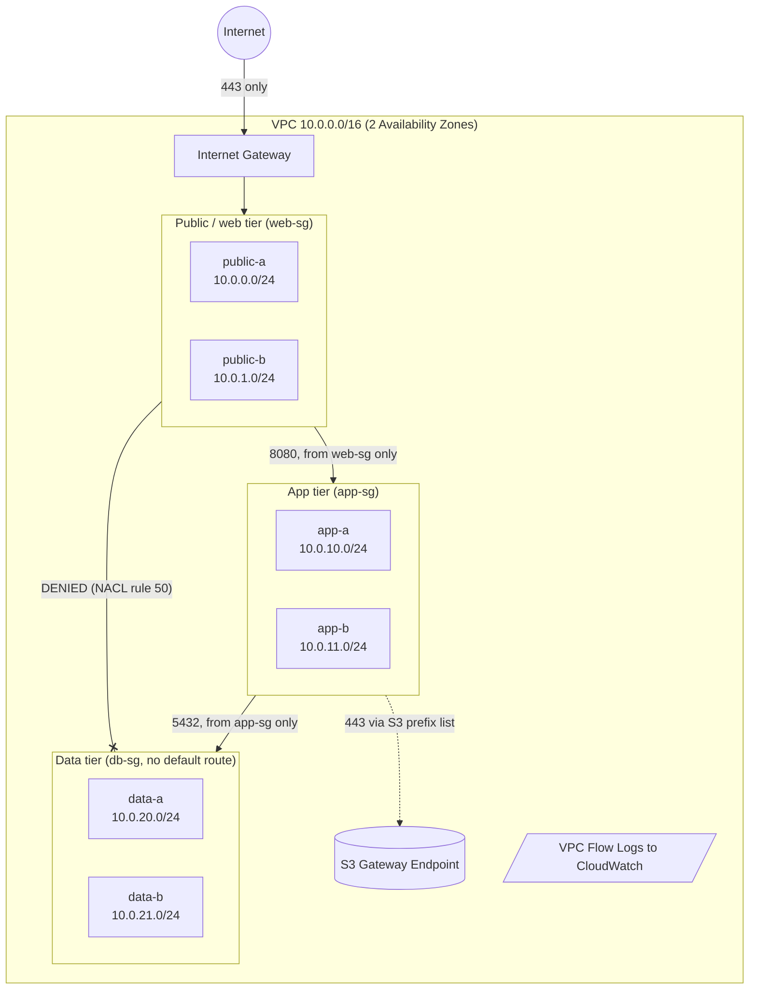
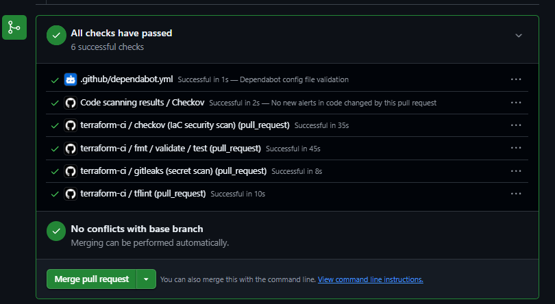
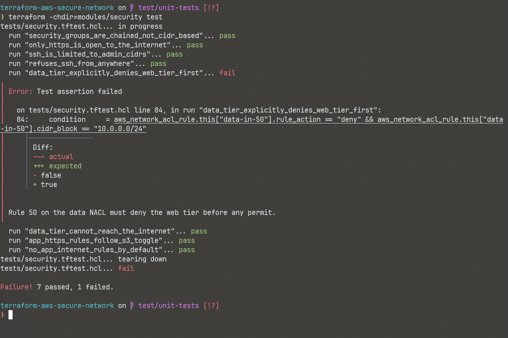
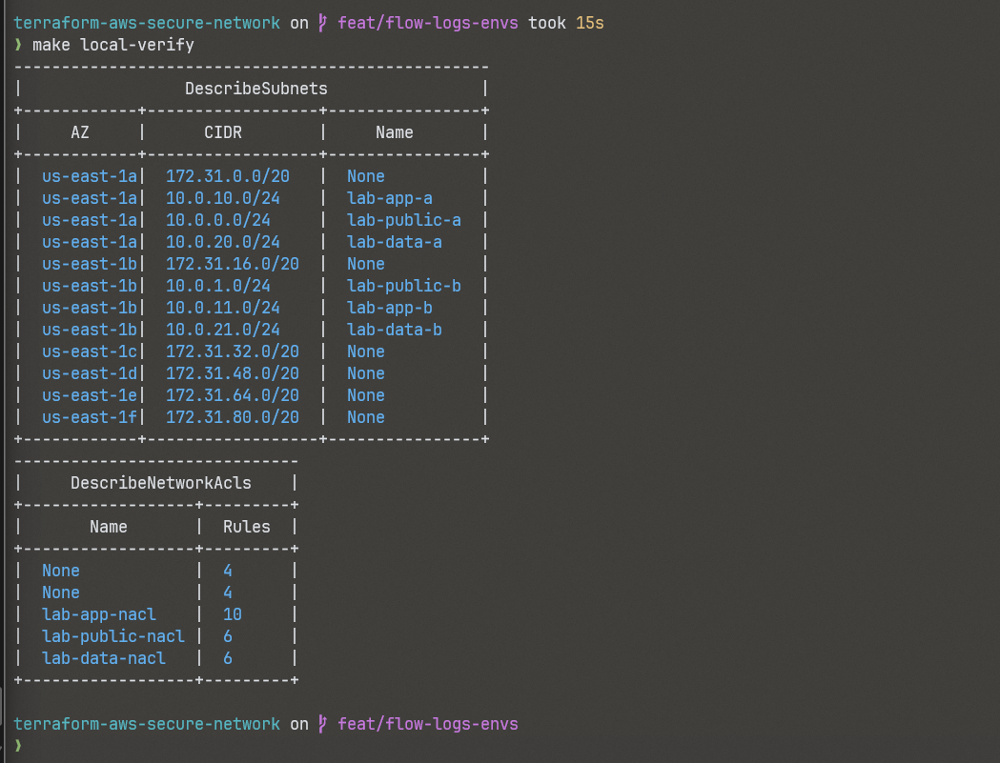

# Secure Three-Tier AWS Network with Terraform

[](https://github.com/PeytonVanW/terraform-aws-secure-network/actions/workflows/terraform-ci.yml)


A multi-AZ AWS VPC split into web, app, and data tiers, built with Terraform.
Security groups and network ACLs only allow new connections in one direction,
from web to app to data, and the data tier has no route to the internet at all. Unit tests check
the important rules, and CI lints and security scans every pull request.

It costs nothing to run. You can build it locally on LocalStack or in a real AWS
account with the default settings.

> **Why I built this:** I'm studying for the Cisco CCNA (200-301) and wanted to
> use what I was learning (VLSM subnetting, ACL sequence numbers, implicit deny,
> stateful and stateless filtering) on real cloud infrastructure.
> [`docs/ccna-to-aws.md`](docs/ccna-to-aws.md) maps each AWS resource to its
> Cisco IOS equivalent and writes the whole policy out as IOS ACLs.

## Architecture



| Tier | Subnets | Route table | Inbound allowed | Can reach internet? |
|---|---|---|---|---|
| public (web) | 10.0.0.0/24, 10.0.1.0/24 | `0.0.0.0/0` to the IGW | 443 from anywhere; 22 from an admin /32 only (optional) | Yes (HTTPS out) |
| app | 10.0.10.0/24, 10.0.11.0/24 | local + S3 endpoint (NAT optional) | 8080 from web-sg only | No, only S3 over a private path |
| data | 10.0.20.0/24, 10.0.21.0/24 | local + S3 endpoint, no default route | 5432 from app-sg only | Never |

More detail: [`docs/architecture.md`](docs/architecture.md)

## Security design

- Every packet passes two separate filters. Stateless NACLs at the subnet edge work like an interface ACL, and stateful security groups on each network interface work like a host firewall.
- The app and data tiers accept traffic only from the security group of the tier in front of them, not from IP ranges. A new web server gets access by joining web-sg, whatever IP it lands on.
- The data tier NACL denies the whole web tier at rule 50, before any permit, the same way you would order an IOS ACL.
- The data tier has no default route, no egress security group rules, and no NACL rule that mentions `0.0.0.0/0`. A unit test fails if any of that changes.
- The app tier reaches S3 through a free gateway endpoint, and its egress rule points at the S3 prefix list instead of `0.0.0.0/0`.
- The VPC's default security group has every rule removed (CIS benchmark), and no subnet hands out public IPs automatically.
- VPC Flow Logs record ACCEPT and REJECT traffic, so there is NetFlow style evidence that the policy holds.
- Input validation refuses a VPC range outside RFC 1918 and refuses SSH from `0.0.0.0/0`.

Full write-up: [`docs/security-design.md`](docs/security-design.md)

## Quick start

### Prerequisites
- Terraform 1.9 or newer, Docker, AWS CLI v2, and make (on Windows, use WSL2 Ubuntu)
- A free [LocalStack account](https://app.localstack.cloud) and auth token for the local option

### Option A: run locally on LocalStack ($0, no AWS account)
```bash
export LOCALSTACK_AUTH_TOKEN="<your token>"   # keep in ~/.bashrc, never in the repo
make local-up       # start LocalStack in Docker
make local-apply    # build the VPC, subnets, routes, SGs, NACLs, flow logs
make local-verify   # list subnets and NACLs with the AWS CLI
make local-destroy && make local-down
```

### Option B: deploy to a real AWS account (free tier safe)
```bash
export AWS_PROFILE=lab                       # credentials stay in ~/.aws, never in code
cd environments/aws
cp terraform.tfvars.example terraform.tfvars # set budget_alert_email
cd ../.. && make aws-plan && make aws-apply
make aws-destroy                             # always tear down when finished
```
With the defaults, nothing here has an hourly cost. See [`docs/cost-safety.md`](docs/cost-safety.md).

## Testing and CI

| Check | Tool | Runs on |
|---|---|---|
| Formatting | `terraform fmt` | pre-commit + CI |
| Syntax and types | `terraform validate` | pre-commit + CI |
| Unit tests (20) | `terraform test` with a mocked AWS provider | CI |
| Linting | TFLint with the AWS ruleset | pre-commit + CI |
| IaC security | Checkov, with results in GitHub code scanning (SARIF) | CI |
| Secret detection | Gitleaks over the full git history | pre-commit + CI |
| Dependency updates | Dependabot | monthly |

The unit tests back up the claims in this README, for example
`data_tier_cannot_reach_the_internet`, `data_tier_explicitly_denies_web_tier_first`,
`security_groups_are_chained_not_cidr_based`, and `refuses_ssh_from_anywhere`.

```bash
make check   # run everything CI runs, locally
```

## Proof it works

Every check passing on a pull request:



I removed the rule 50 deny on purpose to make sure the tests notice. They do:



The six subnets and three NACLs after an apply on LocalStack (the 172.31.x.x subnets
and the unnamed NACLs belong to LocalStack's default VPC):



## Repository layout

```
.
├── modules/
│   ├── vpc/          # VPC, 6 subnets via cidrsubnet(), IGW, route tables, optional NAT, S3 endpoint
│   ├── security/     # Chained security groups + per-tier NACLs (one readable rule table)
│   └── flow-logs/    # Flow logs to CloudWatch, least privilege IAM role
├── environments/
│   ├── localstack/   # $0 local deployment
│   └── aws/          # Real AWS + monthly budget alarm
├── docs/             # Architecture, CCNA to AWS mapping, security design, cost safety
├── .github/          # CI pipeline + Dependabot
├── Makefile          # One-word commands for every workflow
└── docker-compose.yml
```

## Design decisions

| Decision | Why |
|---|---|
| NAT gateway off by default | It bills every hour and per GB. The app tier reaches S3 through a free gateway endpoint instead. |
| One `aws_subnet` resource with `for_each` | Adding a third AZ is a one-line change, with no copied resources. |
| NACL rules kept in a single data table | The policy reads like an access list and is easy to review in a pull request. |
| `aws_vpc_security_group_*_rule` resources | This is what AWS recommends now: one resource per rule, clean diffs, and no conflicts with inline rules. |
| Unit tests against a mocked provider | CI never needs cloud credentials, so no secrets live in GitHub. |
| Local state for the lab | It keeps things simple. Remote S3 state with native locking is ready to turn on in `environments/aws/providers.tf`. |

## Roadmap

- [ ] Add an EC2 web server and an Application Load Balancer, and test the security group chain end to end
- [ ] Add a CloudWatch metric filter and alarm for spikes in REJECT records
- [ ] Add a site-to-site VPN module (IPsec, which lines up with the CCNA WAN topics)
- [ ] Move state to S3 with native locking
- [ ] Add IPv6 dual-stack subnets

## License

[MIT](LICENSE)
