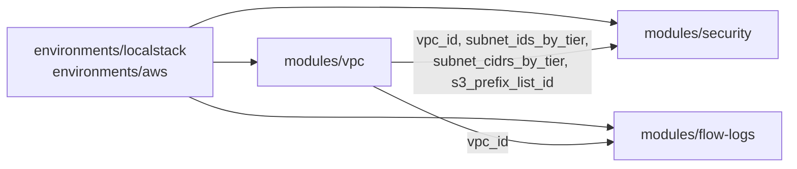

# Architecture

## Module dependency graph

Each module has one job and is tested on its own:

| Module | Responsibility | Key inputs | Key outputs |
|---|---|---|---|
| `vpc` | Addressing and routing (Layer 3) | `vpc_cidr`, `availability_zones`, `enable_nat_gateway` | `subnet_ids_by_tier`, `subnet_cidrs_by_tier`, `s3_prefix_list_id` |
| `security` | Filtering policy (NACLs and SGs) | Subnet maps, `app_port`, `db_port`, `admin_cidrs` | `security_group_ids`, `nacl_rule_table` |
| `flow-logs` | Visibility | `vpc_id`, `retention_in_days` | `log_group_name` |

## Traffic flows

| # | Flow | Path | Allowed? |
|---|---|---|---|
| 1 | Client → web (HTTPS) | Internet → IGW → public RT → public NACL in 100 → web-sg 443 | Yes |
| 2 | Web → app | web-sg egress 8080 → public NACL out 110 → app NACL in 100 → app-sg from web-sg | Yes |
| 3 | App → database | app-sg egress 5432 → app NACL out 200 → data NACL in 100 → db-sg from app-sg | Yes |
| 4 | App → S3 | app-sg egress 443 to S3 prefix list → app RT → gateway endpoint | Yes |
| 5 | Web → database | public NACL out has no rule; data NACL in 50 DENY; db-sg has no rule | No |
| 6 | Database → internet | data RT has no default route; db-sg has no egress | No |
| 7 | Internet → app tier | app subnets aren't routed from the IGW; app-sg accepts only web-sg | No |

## Scaling
- Third AZ: add `"us-east-1c"` to `availability_zones`. Nine subnets are created, and NACL rules for the new CIDRs are generated automatically.
- Different VPC range: change `vpc_cidr`. Every subnet and rule recalculates.
- Production NAT: turn on `enable_nat_gateway`. For real HA, add one NAT per AZ (roadmap).
